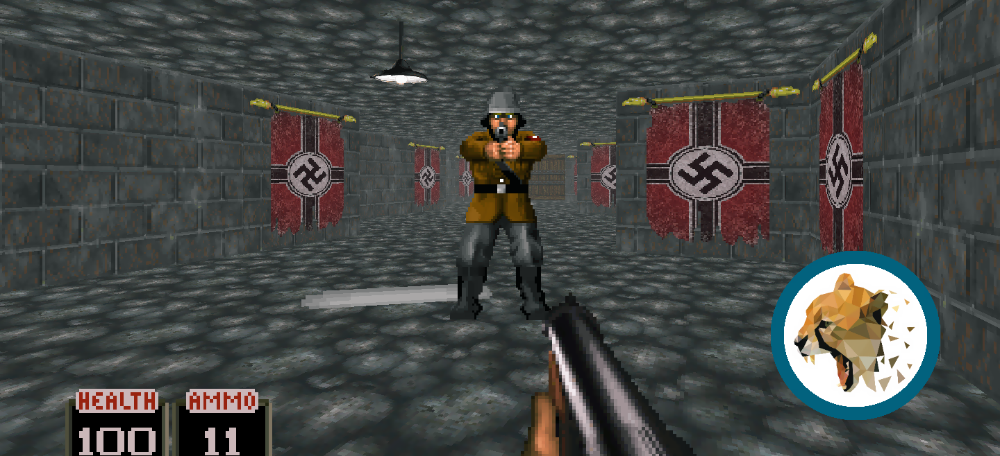

# Cheetah Engine (Java - OpenGL)
Welcome to the Cross-Platform 3D Engine.
As OpenGL Binding for Java the [LWJGL](https://www.lwjgl.org/) API is used.

## About the engine:

Cheetah engine has been writed with Java with the usage of the OpenGL API libraries: LWJGL and slick-utils. It make use of the modern coding and rendering structure for a more expandable and friendly end.

This game engine as well as Auschwitz is currently in developement, so we will keep expanding it as the game need it, thats why we will keep updating every once need it.

The engine is free to use and upgrade, extend or modify so feel free to add, extend or upgrade code and all of your creation will be protected if you follow the code extension licence down below.

## About Auschwitz:

Auschwitz its an FPS based on world war II taking place at one of the concentration camp of Auschwitz, its inspired on those old school
90's FPS on their gameplay as well as their asthetic putting together with modern gameplay and visual desing. 

## About the licence and usage:

All of the current base code and resources belong to cheetah software, the default game assets are protected, but feel free to use them, also make your own if you wan't to. The engine has been shared using the Apache licence 2.0 so check it out at 
http://www.apache.org/licenses/LICENSE-2.0.

If you get to extend, upgrade or modify the base engine, feel free to be the owner of such additions. If you want to publish a game with our engine please be sure to add our name as yours as owners of the original code and any extension of this in the header of the classes and in the final program, and also write us, we'll be glad to see your work ;).

For more information check the in code documentation of the engine.

If you have any problems with the engine code or documentation please don't forget to write the issue.

## System requirements

- OS: `Windows, MacOS, Linux` (x86_64; Apple Silicon runs through Rosetta 2)
- Java: `JDK 17`
- Build: `Gradle 8.10` (bundled through the wrapper, no install needed)
- OpenGL: `2.1 and above`

## Running the project

All commands run from the `cheetah1/` folder. Use the Gradle wrapper rather than a system-wide Gradle, so the build always uses the version it was written for. The first run downloads Gradle and the dependencies, so it needs an internet connection.

Always launch through the `run` task: it sets the working directory that the `./res/...` paths depend on, and points LWJGL at the native libraries in `lib/native/`.

### macOS (Intel)

```sh
cd cheetah1
./gradlew run
```

### macOS (Apple Silicon)

The bundled LWJGL 2 and OpenAL libraries are x86_64 only, so the game has to run on an x86_64 JVM under Rosetta 2. An arm64 JVM can't load them.

1. Install Rosetta 2:

   ```sh
   softwareupdate --install-rosetta --agree-to-license
   ```

2. Download the **macOS x64** `.tar.gz` of JDK 17 from [Adoptium](https://adoptium.net/temurin/releases/?version=17) and extract it into your user folder:

   ```sh
   mkdir -p ~/Library/Java/JavaVirtualMachines
   tar -xzf OpenJDK17U-jdk_x64_mac_hotspot_*.tar.gz -C ~/Library/Java/JavaVirtualMachines
   ```

   The build only looks in `~/Library/Java/JavaVirtualMachines`, for a folder whose name starts with `jdk-`. A `.pkg` installer puts the JDK in `/Library/Java/JavaVirtualMachines`, where it won't be found.

3. Run the game:

   ```sh
   cd cheetah1
   ./gradlew run
   ```

Gradle itself can run on either an arm64 or an x86_64 JDK. On an arm64 JDK, `run` forks the game onto the x86_64 JDK from step 2 automatically.

To check which architecture a JDK is:

```sh
java -XshowSettings:properties -version 2>&1 | grep os.arch
```

### Linux

```sh
cd cheetah1
chmod +x gradlew
./gradlew run
```

Native libraries are provided for x86 and x86_64 only, so ARM Linux isn't supported. LWJGL 2 needs X11 (XWayland works under Wayland) and the `xrandr` command, which is usually in the `x11-xserver-utils` or `xorg-xrandr` package.

### Windows

```bat
cd cheetah1
gradlew.bat run
```

Native libraries are provided for x86 and x86_64 only, so Windows on ARM isn't supported natively.

### Other commands

| Command | What it does |
| --- | --- |
| `./gradlew run --args="--skip-menu"` | Skips the menu and starts at level 1 |
| `./gradlew test` | Runs the unit tests |
| `./gradlew build` | Compiles and runs the tests |
| `./gradlew clean` | Deletes the build output |

On Windows, replace `./gradlew` with `gradlew.bat`.

### Configuration and saved data

- `cheetah1/res/config.txt` holds the engine settings: resolution (`TARGET_WIDTH`, `TARGET_HEIGHT`), `FULLSCREEN`, graphics quality and draw distances (`POP_IN`, `GRASS_POP_IN`, `PARTICLES_POP_IN`). The settings menu writes to this same file, and resolution and fullscreen changes apply on the next launch.
- Saved games are stored in `cheetah1/saves/`, which git ignores.

### Troubleshooting

| Symptom | Cause and fix |
| --- | --- |
| `UnsatisfiedLinkError` or `wrong architecture` on Apple Silicon | The game is running on an arm64 JVM. Follow the Apple Silicon steps above. |
| `Unsupported class file major version` or a Gradle startup error | The default Java is too new for Gradle 8.10. Point `JAVA_HOME` at JDK 17. |
| `AL lib: (EE) ca_open_playback: AudioUnitInitialize failed` on macOS | This message comes from the bundled OpenAL library. Audio can still work, so only look into it if the game is silent. |
| The game crashes and leaves `hs_err_pid*.log` in `cheetah1/` | This is a JVM crash report (git ignores it). The stack trace in it shows where the crash happened. |
| `[===== Crash =====]` in the console, but Gradle reports success | The engine caught the error and closed itself, so check the console output rather than the Gradle result. |

## Credits:

- Carlos Rodriguez : `initial work`
